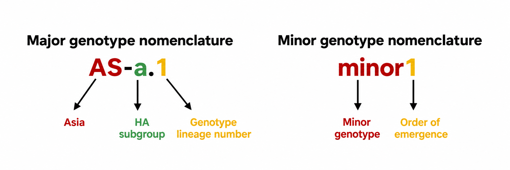

# GenoFLU-Asia

[Documentation website](https://kdca-knu-virusresearch.github.io/GenoFLU-Asia/) · [GitHub repository](https://github.com/KDCA-KNU-VirusResearch/GenoFLU-Asia)

Reference-based genotype assignment for Asian H5 avian influenza viruses in clade 2.3.4.4b, group G2.

## Overview

GenoFLU-Asia was developed from [GenoFLU](https://github.com/USDA-VS/GenoFLU) to provide an integrated framework for classifying highly pathogenic avian influenza (HPAI) H5 viruses of the goose/Guangdong lineage, clade 2.3.4.4b, detected in Asian countries.

**This project was developed as part of a research collaboration with the Korea Disease Control and Prevention Agency (KDCA), Republic of Korea.**

The study focuses on viruses isolated in Asia during **2020–2026** whose **HA genes belong to group G2 of clade 2.3.4.4b**, including reassortants with low pathogenic avian influenza (LPAI) viruses. GenoFLU-Asia considers the constellation of **all eight genome segments—PB2, PB1, PA, HA, NP, NA, M, and NS—to assign genotypes** using an Asia-focused reference sequence set and genotype key. A batch-processing workflow compiles the assignments into a combined Excel workbook.

## Genotype classification and nomenclature

Major and minor designations reflect the number of viruses representing each genotype in the study dataset.

- **Major:** three or more viruses; names encode the HA subgroup.
- **Minor:** fewer than three viruses; numbered in order of emergence without an HA subgroup label.
- **Example — `AS-a.1`:** `AS` = Asia; `a` = HA subgroup; `1` = genotype lineage number.
- **Numerical suffixes:** indicate emergence order or reassortment pattern, as defined in the study nomenclature.
- **Assignment:** major and minor names are recorded in the genotype key.



**Genotype nomenclature.** Naming scheme for major and minor genotypes.

## Installation

GenoFLU-Asia can be used in a Conda environment on Linux or Ubuntu on WSL. Install Conda through Miniforge or Miniconda.

- **Windows users:** open the Ubuntu terminal and run the commands there. Conda must be available inside Ubuntu; installing Conda only on Windows is not sufficient.
- **Command entry:** paste a command and press Enter. Do not copy a terminal prompt such as `(base) user@computer:~$`.
- **Already installed?** If your existing setup works, keep it and go to [Input and execution](#input-and-execution).

### Understand the folders

The project files, Conda environment, and analysis files serve different purposes.

| Item | Purpose | Example |
| --- | --- | --- |
| Project folder | Stores the scripts, reference sequences, and genotype key | `~/projects/GenoFLU-Asia` |
| Conda environment | Provides Python, BLAST, and required packages | Environment named `genoflu-asia` |
| Analysis folder | Stores input FASTA files and output workbooks | `~/genoflu_asia_analysis` |

- **Project location:** keep the project in a working folder; it does not need to be inside Conda's `envs` directory.
- **`~`:** your Linux home folder, for example `/home/user`.
- **`cd`:** changes your current folder. **`conda activate`:** selects an environment without changing folders.
- **Paths:** use English letters, numbers, `_`, `-`, and `.` in project and input folder/file names; avoid spaces, parentheses, and non-ASCII characters.

### 1. Clone the repository — once

Cloning downloads the complete project, including the scripts, reference sequences, and genotype key. First check that Git is available in your Linux or Ubuntu terminal:

```bash
git --version
```

If Ubuntu reports `git: command not found`, install Git, then continue:

```bash
sudo apt update
sudo apt install git
```

When prompted by `sudo`, enter your Ubuntu password; no characters appear while you type.


```bash
mkdir -p ~/projects
git clone https://github.com/KDCA-KNU-VirusResearch/GenoFLU-Asia.git ~/projects/GenoFLU-Asia
cd ~/projects/GenoFLU-Asia
ls
```

- **`mkdir -p`:** creates the parent folder if needed.
- **`git clone`:** downloads the repository into `~/projects/GenoFLU-Asia`.
- **`cd`:** moves into the downloaded project folder.
- **`ls`:** lists its contents; check for `genoflu.py`, `run_genoflu.sh`, `install_command.sh`, and `dependencies/`. Keep them together.
- **Existing copy:** if this folder already contains your project, skip cloning and enter it with `cd`.

### 2. Create the Conda environment — once

First check Conda and existing environments:

```bash
conda --version
conda env list
```

If `genoflu-asia` already exists with the required packages, skip the creation command. Otherwise, run this single-line command:

```bash
conda create -n genoflu-asia --override-channels -c conda-forge -c bioconda python=3.13 pandas=2.3.2 biopython=1.85 openpyxl=3.1.5 blast=2.17.0
```

- **`-n genoflu-asia`:** names the environment.
- **Packages:** Python runs the code; pandas and openpyxl handle tables and Excel files; Biopython handles sequence data; BLAST compares sequences.
- **Confirmation:** if prompted with `Proceed ([y]/n)?`, review the installation list, enter `y`, and wait for installation to finish.
- **Validation:** the release files were tested in the existing Ubuntu 24.04 Conda environment with BLAST 2.17.0, pandas 2.3.2, Biopython 1.85, and openpyxl 3.1.5. A test input containing 14,432 sequences from 1,804 virus IDs produced 1,804 result rows, matching the existing code. Repeated execution and Asia reference defaults were also checked.

### 3. Activate the environment and register the command — once

Run the installer from the project folder after activating the environment:

```bash
conda activate genoflu-asia
cd ~/projects/GenoFLU-Asia
bash install_command.sh
genoflu-asia --help
```

- **Registration:** creates the `genoflu-asia` command in the activated environment, so you can run it from other folders.
- **Check:** `--help` displays usage instructions without starting an analysis; it does not test the full analysis workflow.
- **Already registered:** do not repeat registration. If `Command already exists` appears, first check `genoflu-asia --help`.
- **Project location:** keep the project at its registered location. The installer does not overwrite an existing command if you move the project.

## Input and execution

Use the same input and output folders for each analysis. The analysis folder, `~/genoflu_asia_analysis`, is separate from the program folder, `~/projects/GenoFLU-Asia`.

### Prepare folders

Create the analysis folder and its input/output folders once. No intermediate run folders are needed:

```bash
mkdir -p ~/genoflu_asia_analysis/input ~/genoflu_asia_analysis/output
cd ~/genoflu_asia_analysis
pwd
```

```text
~/genoflu_asia_analysis/
├── input/
│   ├── sample01.fasta
│   └── sample02.fasta
└── output/
```

- **`mkdir -p`:** creates folders if they do not exist. **`pwd`:** shows your current working directory.
- **Copy files:** place your assembled nucleotide FASTA files directly in `input`. On WSL, run `explorer.exe input` from `~/genoflu_asia_analysis` to open that folder in Windows File Explorer.
- **Files:** all lowercase `.fasta` files directly inside the input folder are analyzed; each may contain one or multiple viruses.
- **Extensions:** `.fa`, `.fna`, `.FASTA`, and `.fasta.txt` are not selected by the batch script. Renaming a spreadsheet to `.fasta` does not convert it into sequence data.

### Prepare FASTA headers

All segments of a virus must share the same ID before the first `|`.

- Use IDs without spaces and a distinct ID for each virus.
- Include all eight segments: **PB2, PB1, PA, HA, NP, NA, MP, and NS**.
- Follow each header with its corresponding nucleotide sequence.

Header examples:

```text
>sample01|PB2
>sample01|PB1
```

These are header examples only, not a runnable input file; each must be followed by its corresponding real nucleotide sequence.

### Run

```bash
conda activate genoflu-asia
cd ~/genoflu_asia_analysis
genoflu-asia --input ./input --output ./output
```

- **`conda activate genoflu-asia`:** selects the required environment; repeat this in each new terminal session.
- **`--input ./input`:** reads the `input` folder inside your current directory, not a particular filename.
- **`--output ./output`:** saves results in the `output` folder inside your current directory.
- **Progress:** wait for `All files processed.` and check for errors. Run only one analysis at a time per project folder.

To avoid depending on your current folder, specify the paths explicitly:

```bash
genoflu-asia --input ~/genoflu_asia_analysis/input --output ~/genoflu_asia_analysis/output
```

### Open the results

Open `~/genoflu_asia_analysis/output/genoflu_combined_results.xlsx` in Excel and select the **All Results** sheet. On WSL, open the output folder with:

```bash
explorer.exe ~/genoflu_asia_analysis/output
```

Confirm that all expected virus IDs appear, then use [Interpreting results](#interpreting-results) below to read the assignments.

### Run another analysis

Reuse the same folders; do not recreate the environment, register the command again, or create a new run folder.

1. Move any FASTA files you no longer want to analyze out of `input`, then copy the new files into it. Every `.fasta` file left in this folder will be analyzed.
2. If you need to keep the previous result, rename or copy `output/genoflu_combined_results.xlsx` before running again; the same output filename is reused.
3. Activate the environment and run:

```bash
conda activate genoflu-asia
cd ~/genoflu_asia_analysis
genoflu-asia --input ./input --output ./output
```

- **Interrupted runs:** move aside any workbook left in the project folder before restarting, as new rows may be appended.
- **Without command registration:** run `bash ~/projects/GenoFLU-Asia/run_genoflu.sh --input ~/genoflu_asia_analysis/input --output ~/genoflu_asia_analysis/output` with the environment activated.

## Test the installation

The `test/` folder contains `example_10_genotypes.fasta` (10 viruses, eight segments each) and `expected_results.tsv`. The example covers five distinct major and five distinct minor genotypes. Expected assignments were verified with the bundled Asia references and genotype key; they are software test results, not an independent biological validation.

Run the example using your activated environment:

```bash
conda activate genoflu-asia
genoflu-asia --input ~/projects/GenoFLU-Asia/test --output ~/genoflu_asia_analysis/output
```

- **Previous output:** rename or copy an existing `genoflu_combined_results.xlsx` before running this test if you need to keep it.
- **Expected output:** 10 rows in the **All Results** sheet. Compare each virus ID and its `Genotype` with `test/expected_results.tsv`; the output `sample` field adds a filename-derived prefix followed by `__` before the virus ID.
- **Major genotypes:** `AS-a.1(N6)`, `AS-b.1`, `AS-c.1`, `AS-d.1`, `NA.1(B3.2)`.
- **Minor genotypes:** `minor1(N6)`, `minor3(N6)`, `minor4`, `minor5(N6)`, `minor6(N6)`.
- **Input provenance:** the selected records retain their original FASTA headers, accession identifiers, and nucleotide sequences from the supplied dataset. Major/minor labels follow the study genotype key, not the number of examples in this test file.

## Interpreting results

A genotype is assigned when all eight accepted segment groups match an entry in `genotype_key_asia.xlsx`.

- **Alignment selection:** within each virus and gene, select the highest BLAST bitscore; break ties by alignment length, then percent identity. Apply the configured identity threshold (default: 97%) to the selected alignment.
- **Identity threshold:** BLAST nucleotide identity **≥97% by default** for each accepted segment; configurable with `-p/--pident_threshold`.
- **Alignment scope:** the threshold applies to local alignments; no minimum alignment-coverage filter is applied.

- **Why 97%?** Manual segment-cluster assignment in this study used a 97% pairwise nucleotide identity criterion, with values below 97% treated as evidence of distinct clusters. The default cutoff maintains consistency with that manual classification framework. Pairwise identity used for manual clustering and identity over a BLAST local alignment are not identical measurements; the cutoff is an operational assignment criterion, not a universal cluster boundary.
- **Threshold comparison:** with bitscore-first selection and the same reference set, 97% retained all 1,820 assignments with eight-segment combinations concordant with uniquely matched manual records. At 98%, 44 of those records became unassigned. These are within-dataset concordance results, not independent estimates of diagnostic accuracy; records may overlap between input files.
- **Custom threshold:** use `-p` or `--pident_threshold` with a percentage from 0 to 100 (default: 97). This changes acceptance of the selected alignment, not the bitscore ranking or genotype key. The workbook's `Genotype List Used` column includes the chosen cutoff. Changing the threshold can alter assignments.

For an optional 98% comparison (save any previous output first):

```bash
genoflu-asia --input ./input --output ./output --pident_threshold 98
```

The equivalent short option is `-p 98`. Direct Python use also supports the option:

```bash
python ~/projects/GenoFLU-Asia/genoflu.py -f ./input/sample01.fasta -p 98
```

| Result or column | Meaning |
| --- | --- |
| `Genotype` | Assigned genotype; a `minor` name is also a valid assignment. |
| `Not assigned: No Matching Genotypes` | Eight accepted segments form a combination absent from the key; this alone does not establish a novel genotype. |
| `Not assigned: Only ... segments ...` | Fewer than eight segments pass the threshold; check missing segments, sequence quality, and FASTA IDs. |
| `Genotype Percent Match List` | Percent identities of the selected reference alignments. |
| `Genotype Mismatch List` | Mismatching-base counts within the corresponding alignments. |

- **List order:** match identity and mismatch entries to gene labels in `Genotype Sample Title List`; do not assume a fixed segment order.
- **Completeness:** confirm that all expected virus IDs appear in the workbook.
- **Date:** `date` records the analysis date.
- **Read depth:** unavailable from FASTA input.
- **Setup errors:** check environment activation, dependencies, and lowercase `.fasta` extensions.

## Reference Database Structure

GenoFLU-Asia follows the reference-sequence and genotype-key approach described in [GenoFLU](https://github.com/USDA-VS/GenoFLU#-reference-database-structure).

```text
dependencies/
├── asia_fastas/
│   ├── PB2.fasta
│   ├── PB1.fasta
│   ├── PA.fasta
│   ├── HA.fasta
│   ├── NP.fasta
│   ├── NA.fasta
│   ├── MP.fasta
│   └── NS.fasta
└── genotype_key_asia.xlsx
```

### Reference FASTA files

Each FASTA file contains reference nucleotide sequences for one segment.

- All reference FASTA files are combined to build the BLAST database.
- Reference headers use three `|`-separated fields: `segment_group|reference_id|gene`.
- Illustrative header: `>PB2_group1|reference_001|PB2`, followed by its nucleotide sequence.
- `PB2_group1` identifies the segment group; `reference_001` identifies the reference; `PB2` identifies the gene.
- Reference headers differ from the input-virus headers described [above](#prepare-fasta-headers).

### Genotype key

`genotype_key_asia.xlsx` maps genotype names to their eight-segment combinations.

- **Columns:** `Genotype`, `PB2`, `PB1`, `PA`, `HA`, `NP`, `NA`, `MP`, and `NS`.
- **Identifiers:** segment-group values must exactly match the reference FASTA headers.
- **Matching:** the accepted eight-segment combination determines the genotype assignment.
- **Updates:** keep reference sequences and the key consistent; segment-group identifiers are distinct from whole-virus genotype names such as `AS-d.1`.

## Acknowledgments and license

Developed in collaboration with the **Korea Disease Control and Prevention Agency (KDCA), Republic of Korea**, and based on [USDA-VS/GenoFLU](https://github.com/USDA-VS/GenoFLU).

- **Software:** based on USDA-VS/GenoFLU; the upstream GPL-3.0 license is included in [LICENSE](LICENSE). This adaptation adds Asia-specific reference sequences and genotype keys, batch processing, and combined Excel output.
- **Sequence data:** follow source-specific terms and acknowledgments, including GISAID where applicable.
- **Citation:** the study citation and release identifier will be added when available.
